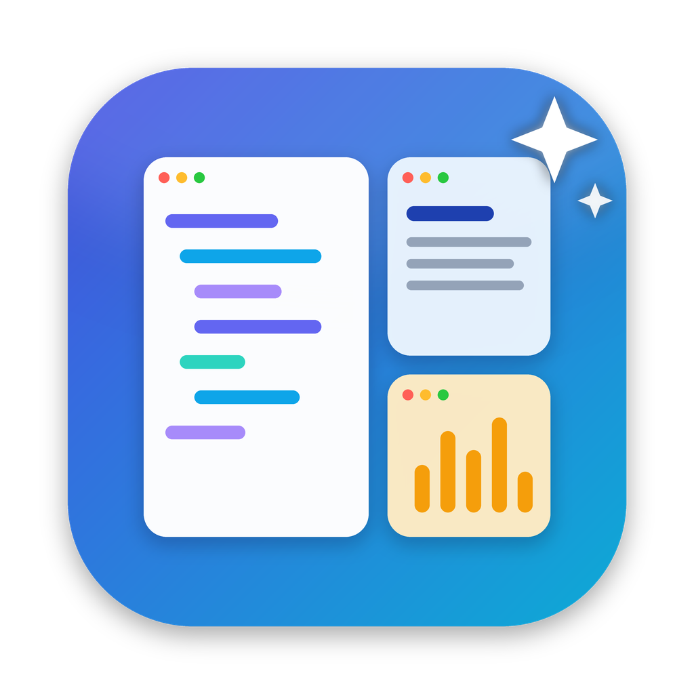

<p align="center">
  
</p>

<h1 align="center">SmartTile：会学习你习惯的自动分屏</h1>

<p align="center"><a href="README.md">English</a> | <b>简体中文</b></p>

一个 macOS 菜单栏小工具。它根据你正在用的应用，把窗口自动分到合适的屏幕和区域，并从你的操作中学习：
- 拖动两个窗口之间的边缘，它会记住新比例，相邻窗口立刻跟着让位；
- 把窗口拖进别的区，它会记住这个窗口属于哪个区；
- 刷题、写代码、上课可以各存一套布局（场景），并根据打开的窗口自动切换；
- 界面语言跟随系统（简体中文 / English）。

## 一、编译运行

需要 macOS 13 及以上版本，以及 Xcode 或 Xcode 命令行工具。

```bash
cd SmartTile
./build.sh --install          # 编译、安装到 /Applications 并启动
```

第一次运行 build.sh 会在钥匙串里创建一个本地签名证书「SmartTile Dev」。中途可能弹出两种提示：
- 要求输入登录密码来信任证书：输入即可，取消也能继续；
- “codesign 想要访问钥匙串”：点**始终允许**。

有了固定签名，以后重新编译就**不用每次重新授权**了。

> **从旧版本升级**：旧版本用的是临时签名，换成新证书后需要再授权最后一次：
> `./build.sh --install --reset`，然后在 **系统设置 → 隐私与安全性 → 辅助功能** 里重新打开 SmartTile。

运行单元测试：`./build.sh --test`，或者直接 `swift test`。如果只装了命令行工具、提示找不到 XCTest，就用 Xcode 打开 `Package.swift`，按 ⌘U 运行。

## 二、快捷键

| 快捷键 | 功能 |
|---|---|
| ⌃⌥L | 立即智能分屏 |
| ⌃⌥Z | 撤销上一次分屏或比例调整（最多 15 步） |
| ⌃⌥Space | 窗口切换器：按角色分组、显示标题，按数字键直接选择 |
| ⌃⌥1 / 2 / 3 | 跳到主工作区 / 参考区 / 辅助区，连按在同类窗口间轮换 |
| ⌃⌥S | 把当前布局保存到当前场景 |
| ⌃⌥N | 切换到下一个场景 |

## 三、它怎么分屏

每个窗口都有一个角色：

- **主工作**：VS Code、Cursor、Xcode、JetBrains、终端
- **参考**：浏览器、PDF、Notion、Obsidian（不认识的应用默认也算参考）
- **辅助**：Spotify、Apple Music、网易云、微信、QQ、Discord、邮件、访达
- 浏览器窗口还会按标题细分：标题含 YouTube 或 bilibili 的算辅助，含 LeetCode 的算参考

| 屏幕数 | 默认布局 |
|---|---|
| 1 块 | 左 60% 放主工作；右边上 62% 放参考，下 38% 放辅助 |
| 2 块 | 主屏放主工作；另一块屏左边放参考，右边放辅助 |
| 3 块 | 主屏放主工作，左屏放参考（最多两个），右屏放辅助和多出来的参考窗口 |

同一区域放不下的窗口会叠在同一个位置，大小完全一致，用 ⌃⌥Space 切换。

## 四、它学什么

| 你的操作 | 它学到什么 |
|---|---|
| 拖动两个窗口之间的边缘（比如把 VS Code 右边往右拉） | **区域比例**：立即记住，相邻窗口马上让位；按 ⌃⌥Z 可以撤销 |
| 把一个窗口连续两次拖进别的区（比如把微信拖到参考区） | **窗口角色**：以后它就放在那个区；拖回原来的区就恢复 |
| 把代码窗口拖到另一块屏幕 | **主屏**：以后代码放那块屏 |
| 平时在哪块屏幕写代码最多 | **主屏**：根据使用时长自动判断（拖动的结果优先） |
| 最近用过哪些窗口 | 分屏时最近用的窗口优先占据显眼位置，久不用的叠在后面 |

拖动屏幕外侧的边不会被学习，下次分屏会恢复。只有用鼠标做的调整才会被学习，应用自己调整窗口大小不算。

### 手动摆放的窗口不会被复位

你用鼠标移动或缩放过的窗口，SmartTile 会让它留在原处。自动整理（新窗口归位、比例调整）都会跳过它，直到你主动整理：按 ⌃⌥L、选择场景，或者插拔显示器。菜单里会显示当前保留了几个窗口。

### 同一应用的其他窗口

每个应用只有一个窗口参与分屏。这个应用打开的其他窗口，比如微信里点开的图片、浏览器的第二个窗口，会留在应用打开它的位置，也就是它的主窗口旁边。如果它打开在另一块屏幕上，会被挪到主窗口旁边。按标题单独识别的窗口算作独立的应用，会单独分屏。想让所有窗口都参与分屏，在菜单里关掉 **同一应用的其他窗口留在旁边（不参与分屏）**。

所有数据只保存在本机的 `~/Library/Application Support/SmartTile/`：
- `config.json`：规则
- `habits.json`：使用习惯
- `scenes.json`：场景

## 五、场景

场景就是一套布局。每个场景有自己的区域比例，也可以保存每个窗口的精确位置。

1. 把窗口摆成你刷题时喜欢的样子；
2. 菜单栏 → 场景 → **新建场景（用当前布局）…**，起名“刷题”；
3. 以后同样的窗口组合出现时（比如 VS Code 加上标题含 LeetCode 的浏览器窗口），按 ⌃⌥L 会**自动切换到“刷题”**并恢复布局。

自动切换的规则：只看主工作和参考窗口的组合（音乐、聊天开没开不影响），重合度超过一半的场景会被选中，否则用默认的“日常”场景。手动选过场景后，在窗口组合变化之前不会自动切走。

场景里没保存过的窗口：同一个应用的叠到已保存的窗口上，同一个角色的也叠上去，其余的按模板放。

## 六、按标题单独识别窗口

同一个浏览器开了好几个窗口时，可以让某一个被单独识别（比如“题目窗口”）：

切到那个窗口 → 菜单栏 →「Chrome 的角色」→ **按标题单独识别当前窗口…** → 输入标题里的关键词（比如 `LeetCode`、`CS 225`）。

之后这个窗口在场景、学习里都和其他 Chrome 窗口分开记忆。

## 七、自动行为（都可以在菜单里关掉）

- **新窗口自动归位**：新打开的窗口约 0.5 秒后放进对应区域（只移动新窗口）。
- **同一应用的其他窗口留在旁边（不参与分屏）**。
- **插拔显示器时自动分屏**。
- **根据打开的窗口自动切换场景**。
- **从手动调整中学习**。
- **开机自动启动**（需要先 `./build.sh --install` 安装到“应用程序”）。

## 八、自定义规则

菜单 → “编辑规则文件…” 会打开 `config.json`，改完后点“重新加载规则”。

```jsonc
{
  "appRoles": { "com.microsoft.VSCode": "main", "com.google.Chrome": "reference" },
  "titleRules": [
    { "contains": "LeetCode", "role": "reference", "appRole": "reference" },   // 对所有浏览器生效
    { "contains": "CS 225", "role": "reference", "bundleID": "com.google.Chrome" } // 只对 Chrome 生效
  ],
  "gap": 8,                        // 窗口间距
  "singleScreenMainRatio": 0.6,    // 单屏时代码区的默认宽度（拖动边缘学到的比例优先）
  "mainScreenIndex": 1             // 指定主屏（从左往右数，0 开始）；删掉这一行就是自动
}
```

## 九、界面语言

界面文字放在 `Resources/<语言>.lproj/Localizable.strings` 里，以英文原文作为 key，`build.sh` 会把它们复制进 App。语言跟随系统设置；也可以在 **系统设置 → 通用 → 语言与地区 → 应用程序** 里给 SmartTile 单独选语言。

添加新语言：
1. 把 `Resources/en.lproj` 复制成 `Resources/<代码>.lproj`（比如 `ja.lproj`），翻译其中的值；
2. 在 `Resources/Info.plist` 的 `CFBundleLocalizations` 里加上这个语言代码。

## 十、代码结构

```
Sources/SmartTile/
├── main.swift            入口（菜单栏应用，不显示 Dock 图标）
├── AppDelegate.swift     菜单、快捷键、场景菜单、开机自启、统计窗口
├── Controller.swift      核心：窗口事件处理、分屏与撤销、比例/角色/主屏学习、场景切换、切换器
├── WindowEvents.swift    AXObserver：监听窗口创建、移动、缩放、焦点变化
├── LayoutEngine.swift    布局算法（纯函数）：区域切分、分界线、场景位置
├── Store.swift           config / habits / scenes 三份数据的读写和学习逻辑
├── Accessibility.swift   macOS Accessibility API 封装、坐标转换
├── HotKeys.swift         Carbon 全局快捷键、闭包菜单项
├── Models.swift          角色、规则、场景等数据结构和默认规则
├── L10n.swift            本地化辅助函数
└── StatsView.swift       SwiftUI 统计界面
Resources/
├── Info.plist
├── AppIcon.icns / AppIcon.png   App 图标（由 scripts/generate_icon.py 生成）
├── en.lproj/Localizable.strings
└── zh-Hans.lproj/Localizable.strings
Tests/SmartTileTests/
└── LayoutEngineTests.swift   布局算法单元测试
scripts/
└── generate_icon.py       绘制 App 图标（需要 pip3 install pillow numpy）
.github/workflows/ci.yml   每次推送自动跑测试并打包 App
```

## 十一、自动构建（CI）

每次推送或提交 Pull Request，GitHub Actions 都会跑一遍单元测试，并打包一个临时签名的 `SmartTile.app`，可以在那次运行的 **Artifacts** 里下载。从别人电脑上编出来的临时签名 App，第一次打开会被系统拦下：右键点 App 选“打开”即可，或者自己编译。

## 十二、已知限制

- 只管理**当前桌面（Space）**上的窗口。macOS 没有公开的跨 Space 移动窗口接口。
- 全屏、最小化的窗口，以及系统设置这类固定大小的窗口不会被管理。
- 少数应用有最小尺寸限制，可能比分到的区域稍大一些。
- 场景里保存的是精确位置，所以没有可以拖动的分界线；想调整就重新摆好，再按 ⌃⌥S。

## 十三、开源协议

[MIT](LICENSE)
